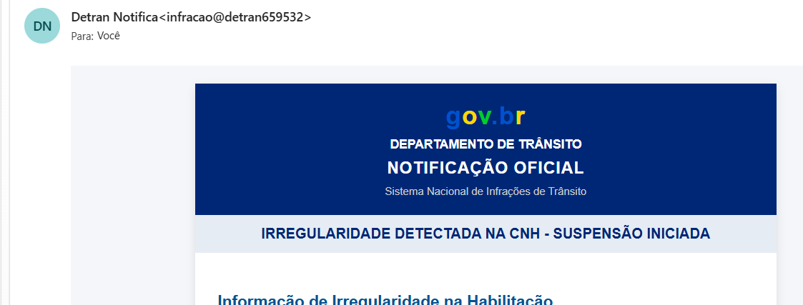
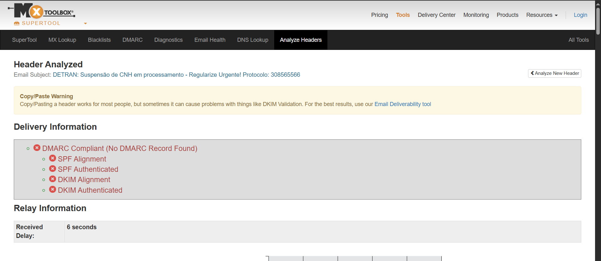
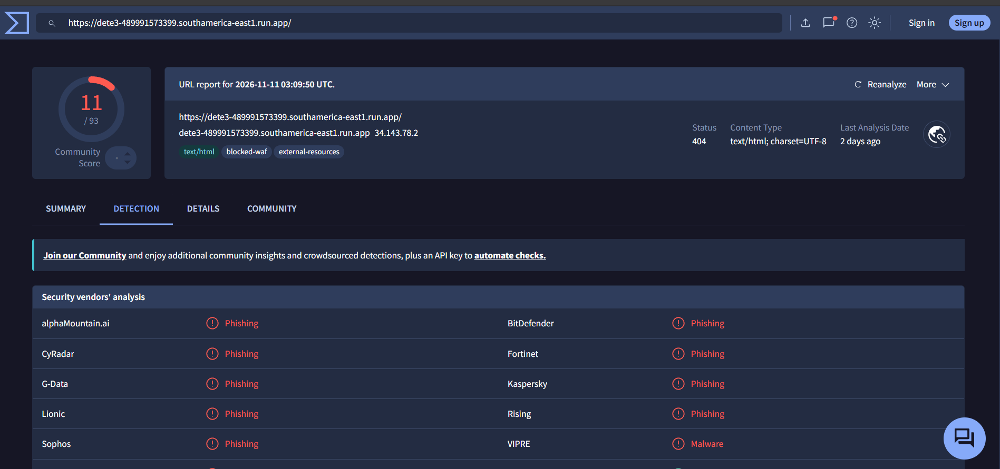
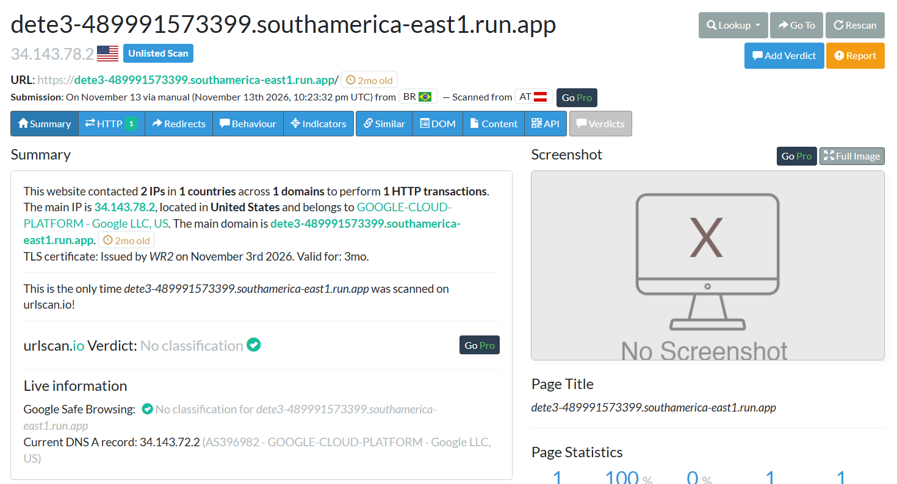
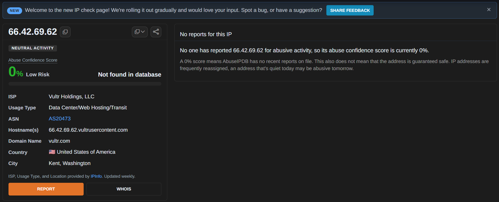
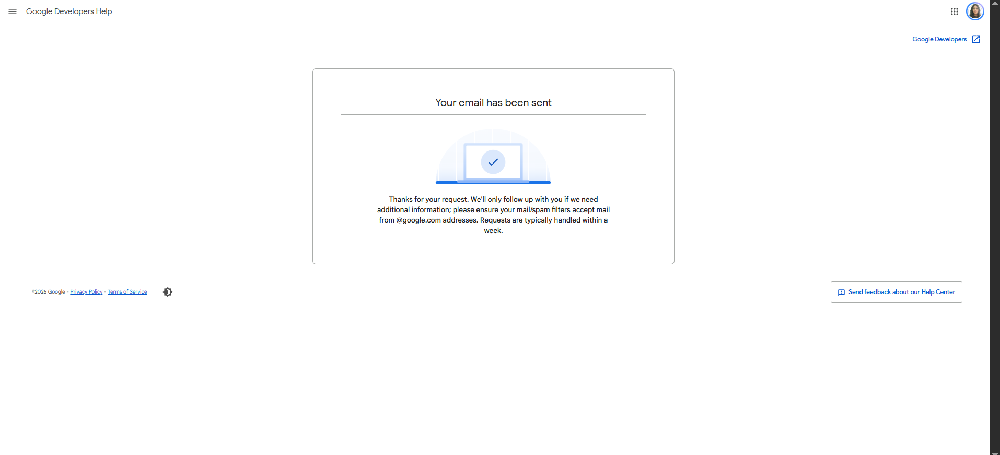
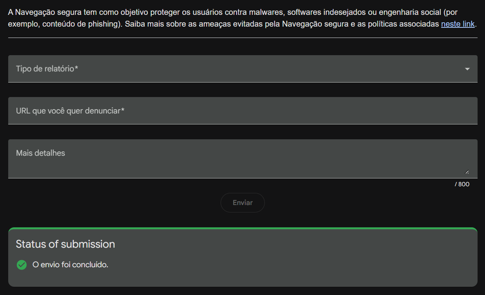
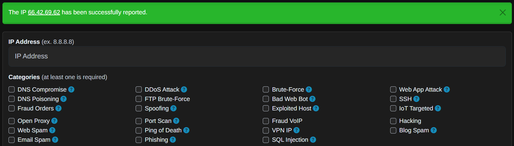
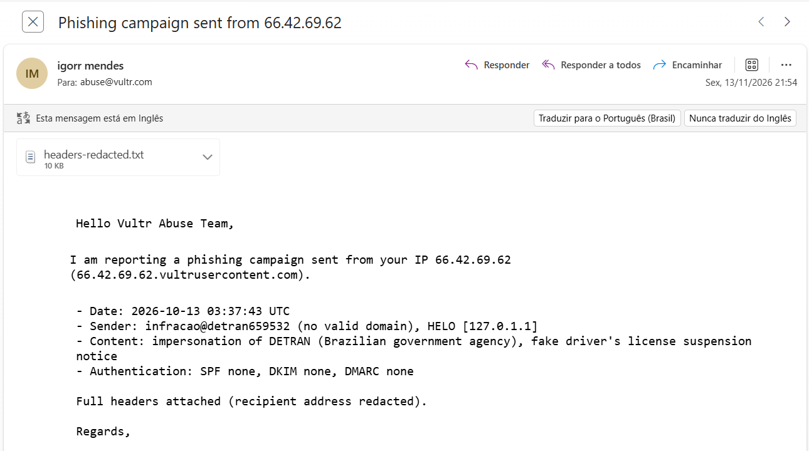

# 01 — Análise de Phishing: Falso DETRAN "Suspensão de CNH"

> Investigação de um e-mail de phishing real recebido em uma caixa pessoal (Outlook.com), conduzida com a metodologia de um analista de SOC N1. Nenhum link foi acessado: toda a análise foi feita de forma estática, sobre o arquivo `.eml`, e com consultas OSINT passivas.

📄 **Relatório de 1 página:** [relatorio.pdf](relatorio.pdf)

## Resumo executivo

| Campo | Valor |
|---|---|
| Data de recebimento | 13/10/2026 03:37:43 UTC (00:37 BRT) |
| Assunto | `DETRAN: Suspensão de CNH em processamento - Regularize Urgente! Protocolo: 308565566` |
| Remetente exibido | `Detran Notifica <infracao@detran659532>` |
| Marca imitada | DETRAN / gov.br |
| Tipo | Phishing por link (*credential harvesting / fraude financeira*) |
| Destino do link | Aplicação no **Google Cloud Run** (região `southamerica-east1`, São Paulo) |
| Origem | VPS da **Vultr** (`66.42.69.62`, EUA) |
| Detecção da URL | **11/93** fornecedores no VirusTotal (Phishing); Google Safe Browsing: sem classificação |
| Veredito | 🔴 **Malicioso — phishing confirmado** |
| Severidade | **Média**: e-mail retido no Lixo Eletrônico (SCL 9) e sem interação do usuário |

**Conclusão:** o e-mail se passa pelo DETRAN para ameaçar a vítima com a suspensão da CNH e levá-la a um site falso hospedado em nuvem pública. Ele falhou em todos os controles de autenticação (SPF, DKIM, DMARC), não tem um domínio de remetente válido e saiu de um servidor alugado (VPS). O filtro da Microsoft classificou a mensagem como spam de alta confiança.

---

## Metodologia

1. Exportação do e-mail em `.eml`, sem abrir links ou anexos
2. Análise dos cabeçalhos: `Received`, `From`, `Return-Path`, `Message-ID`, `Authentication-Results`
3. Verificação de autenticação: SPF, DKIM e DMARC
4. Decodificação do corpo (MIME / base64 / HTML) de forma offline com o script [`analisar_eml.py`](analisar_eml.py), desenvolvido com apoio de IA (só bibliotecas padrão do Python, sem acesso à internet)
5. Extração e *defang* das URLs
6. OSINT passivo do IP de origem (RDAP/WHOIS)
7. Análise de engenharia social e mapeamento MITRE ATT&CK
8. Classificação, contenção e recomendações

---

## 1. Análise de cabeçalhos

### Caminho do e-mail (de baixo para cima)

```
[127.0.1.1] (66.42.69.62)                ← servidor do atacante (VPS Vultr)
   └─► ZR1PEPF0000E462.mail.protection.outlook.com   (gateway EOP da Microsoft)
        └─► PA7P264CA0523.outlook.office365.com
             └─► RO2PR80MB6676.lamprd80.prod.outlook.com
                  └─► CPUPR80MB6947.lamprd80.prod.outlook.com  (caixa da vítima)
```

| Cabeçalho | Valor | Observação |
|---|---|---|
| `From` | `infracao@detran659532` | ⚠️ **Não existe domínio**: não há TLD (`.gov.br`). Endereço inválido. |
| `Return-Path` | `infracao@detran659532` | Igual ao `From`, sem domínio real |
| `Message-ID` | `<1791862663.6106918.398501@detran659532>` | Gerado por script, com o mesmo pseudo-domínio |
| `Received` (1º salto) | `from [127.0.1.1] (66.42.69.62)` | ⚠️ HELO como **localhost**, típico de script de disparo em massa num VPS mal configurado |
| `X-Sender-IP` | `66.42.69.62` | IP real de origem |
| `X-MS-Exchange-Organization-SCL` | `9` | Nota máxima de spam da Microsoft |
| `X-Microsoft-Antispam-Mailbox-Delivery` | `RF:JunkEmail` | Entregue diretamente no Lixo Eletrônico |
| `To` | `[REDACTED]` | Vítima chamada pelo e-mail, não pelo nome: sinal de campanha em massa |

### Autenticação

```
Authentication-Results: spf=none (sender IP is 66.42.69.62) smtp.mailfrom=detran659532;
                        dkim=none (message not signed); dmarc=none action=none
```

| Controle | Resultado | Interpretação |
|---|---|---|
| SPF | `none` | Sem domínio, não há registro SPF para validar o IP |
| DKIM | `none` | Mensagem sem assinatura digital |
| DMARC | `none` | Nenhuma política aplicável |

Um órgão público real enviaria a partir de um domínio `*.gov.br` com SPF, DKIM e DMARC válidos (`pass`).

---

## 2. Análise do corpo e da URL

O e-mail tem duas partes MIME:
- `text/plain` (base64): `"O HTML nao foi carregado corretamente."`, texto de preenchimento
- `text/html`: o conteúdo de fato, com **um único link** (o botão "REGULARIZAR SITUAÇÃO DA CNH")

### O truque do `@` na URL

```
hxxps://www[.]office[.]com-pt-br333593896principal@dete3-489991573399[.]southamerica-east1[.]run[.]app
```

Pela especificação de URLs (RFC 3986), **tudo o que vem antes do `@` é "userinfo"** (usuário e senha) e é ignorado na hora de resolver o destino. Ou seja:

| Parte | Valor | Função |
|---|---|---|
| Userinfo (isca) | `www.office.com-pt-br333593896principal` | Faz a URL **parecer** ser do `office.com` |
| **Host real** | `dete3-489991573399.southamerica-east1.run.app` | Destino real: um serviço no **Google Cloud Run** |

Por que o atacante usa o Cloud Run:
- o domínio `run.app` pertence ao Google e **tem boa reputação**, o que ajuda a passar por filtros de URL;
- o certificado HTTPS é válido e automático, então aparece o "cadeado";
- a região `southamerica-east1` (São Paulo) tem latência baixa para vítimas no Brasil e parece mais legítima para soluções de geolocalização;
- o serviço é descartável: dá pra derrubar e recriar com outro nome em minutos.

### Outras técnicas de evasão encontradas no HTML

| Técnica | Evidência |
|---|---|
| Logo sem imagem | "gov.br" montado com `<span>` coloridos (`g` `o` `v` `.` `b` `r` em azul, amarelo e verde), sem imagem externa para ser bloqueada ou analisada |
| Nenhum recurso externo | Sem ``, `<script>`, `<iframe>` ou `<form>`: o e-mail é "limpo" para os scanners e só o link é malicioso |
| Texto alternativo genérico | A parte `text/plain` não tem link, então filtros que leem só o texto não encontram nada |

### Inconsistências de conteúdo (sinais para o usuário final)

- Protocolo no assunto (`308565566`) **diferente** do protocolo no corpo (`DT-785432-2026`)
- Diz ser o "Departamento **Estadual** de Trânsito", mas usa endereço federal em Brasília/DF
- Destinatário chamado pelo e-mail, não pelo nome nem pelo CPF
- Infração genérica ("excesso de velocidade em via urbana"), sem placa, local ou data
- Prazo curto: **3 dias** (16/10/2026)
- Envio às 00:37 (horário de Brasília)
- O DETRAN notifica infrações pelos canais oficiais (Carteira Digital de Trânsito, SNE, correspondência), não por e-mail com link

---

## 3. Engenharia social

| Gatilho | Trecho |
|---|---|
| **Autoridade** | "NOTIFICAÇÃO OFICIAL", "Sistema Nacional de Infrações de Trânsito", logo gov.br, CNPJ e endereço |
| **Medo** | "Suspensão imediata da CNH por até 12 meses", "Possível apreensão do veículo" |
| **Urgência** | "Regularize Urgente!", "PRAZO PARA REGULARIZAÇÃO: 16/10/2026" |
| **Falsa legitimidade** | "você receberá um comprovante por e-mail", "não responda este e-mail" |

O objetivo provável da página de destino é coletar **CPF, dados da CNH e credenciais gov.br** e/ou cobrar uma **"multa" via Pix**, um padrão recorrente em campanhas contra brasileiros.

---

## 4. Indicadores de Comprometimento (IOCs)

| Tipo | Valor (defanged) | Contexto |
|---|---|---|
| IPv4 | `66[.]42[.]69[.]62` | Servidor de envio, Vultr Holdings LLC (AS20473), EUA |
| Hostname | `66[.]42[.]69[.]62[.]vultrusercontent[.]com` | rDNS genérico de VPS |
| URL | `hxxps://www[.]office[.]com-pt-br333593896principal@dete3-489991573399[.]southamerica-east1[.]run[.]app` | Link de phishing |
| Domínio | `dete3-489991573399[.]southamerica-east1[.]run[.]app` | Host real da página falsa (Google Cloud Run) |
| Remetente | `infracao@detran659532` | `From` / `Return-Path` |
| Message-ID | `1791862663.6106918.398501@detran659532` | — |
| Assunto | `DETRAN: Suspensão de CNH em processamento - Regularize Urgente! Protocolo: 308565566` | — |
| SHA-256 (.eml) | `3f57a8387d1b8dd3ec756dc62a9ee1c74160a91b9510ee2299b53e454943fe82` | Amostra analisada |

Também disponíveis em [`iocs.csv`](iocs.csv).

### Reputação (OSINT)

| Fonte | Indicador | Resultado |
|---|---|---|
| RDAP / ARIN | `66.42.69.62` | Bloco `NET-66-42-68-0-23`, **Vultr Holdings, LLC**, Seattle/WA (EUA) |
| MXToolbox Header Analyzer | Cabeçalhos | ❌ DMARC Compliant (*No DMARC Record Found*), ❌ SPF Alignment, ❌ SPF Authenticated, ❌ DKIM Alignment, ❌ DKIM Authenticated. Entrega em 6 s pela infraestrutura do Exchange Online. |
| VirusTotal | URL | 🔴 **11/93 detecções**: *Phishing* (alphaMountain.ai, BitDefender, CyRadar, Fortinet, G-Data, Kaspersky, Lionic, Rising, Sophos…) e *Malware* (VIPRE). Última análise em 11/11/2026: **HTTP 404**, tags `blocked-waf` e `external-resources`. |

**Interpretação:** a comunidade de segurança já reconhece a URL como phishing (11 fornecedores), mas o Google Safe Browsing ainda não, então usuários do Chrome não veriam aviso nenhum. Hoje o host responde **404** para os scanners, que estão fora do Brasil. Isso indica que a página foi removida **ou** que existe *cloaking* por geolocalização (o urlscan, rodando da Áustria, também não conseguiu capturar a página). Os dois cenários são comuns em kits de phishing direcionados ao Brasil.
| URLscan.io | URL | Scan de 13/11/2026 (scanner na Áustria): host ativo em `34.143.78.2` (Google Cloud, AS396982), TLS emitido pela Google Trust Services (WR2) em 03/11/2026, **sem screenshot e sem classificação**. Era o primeiro scan público desse host. |
| Google Safe Browsing | Domínio | **Sem classificação**: o host ainda não estava marcado como malicioso um mês após a campanha |
| AbuseIPDB | `66.42.69.62` | **0%, sem denúncias** (13/11/2026). ISP Vultr, uso *Data Center/Web Hosting*, AS20473, Kent/WA. A ausência de histórico é típica de VPS recém-alugado e descartável, não indica que o IP é seguro. |

---

### Evidências

<details open>
<summary><b>E-mail renderizado</b>: logo "gov.br" montado com texto colorido</summary>


</details>

<details>
<summary><b>MXToolbox</b>: 0 de 5 controles de autenticação</summary>


</details>

<details>
<summary><b>VirusTotal</b>: 11/93 detecções</summary>


</details>

<details>
<summary><b>urlscan.io</b>: host no Google Cloud, sem classificação no Safe Browsing</summary>


</details>

<details>
<summary><b>AbuseIPDB</b>: IP de origem sem histórico (VPS Vultr)</summary>


</details>

<details>
<summary><b>Denúncia ao Google Cloud Abuse</b></summary>


</details>

<details>
<summary><b>Denúncia ao Google Safe Browsing</b></summary>


</details>

<details>
<summary><b>Denúncia ao AbuseIPDB</b></summary>


</details>

<details>
<summary><b>Denúncia à Vultr (provedor do servidor de envio)</b></summary>


</details>

---

## 5. MITRE ATT&CK

| Tática | Técnica | Aplicação |
|---|---|---|
| Resource Development | **T1583.003** Acquire Infrastructure: Virtual Private Server | VPS Vultr para disparo |
| Resource Development | **T1583.006** Acquire Infrastructure: Web Services | Google Cloud Run para hospedar a página falsa |
| Initial Access | **T1566.002** Phishing: Spearphishing Link | Link no corpo do e-mail |
| Defense Evasion | **T1656** Impersonation | Se passa pelo DETRAN / gov.br |
| Defense Evasion | **T1036** Masquerading | URL com `office.com` antes do `@` |
| Execution | **T1204.001** User Execution: Malicious Link | Depende do clique da vítima |

---

## 6. Resposta e recomendações

**Ações tomadas (cenário pessoal)**
- ✅ Nenhum clique no link e nenhuma interação
- ✅ E-mail mantido em quarentena (Lixo Eletrônico) e reportado como phishing à Microsoft
- ✅ Amostra preservada em `.eml` para análise (fora do repositório)

**Notificações enviadas**

| Data | Destino | Indicador | Status |
|---|---|---|---|
| 13/11/2026 | Google Cloud Platform Abuse | `dete3-489991573399[.]southamerica-east1[.]run[.]app` | ❌ Ticket `3PDGZ6DX7MWGMBLVGMMGCWYT4A` encerrado: a automação avaliou o IP da Vultr citado no texto ("não hospedado no Google Cloud") |
| 13/11/2026 | Google Cloud Platform Abuse (reenvio) | Somente a URL do Cloud Run e o IP `34[.]143[.]78[.]2` | ❌ Ticket `XZMESDHVMAVPID7EXE5KIOJBI4` encerrado com o mesmo motivo. O IP do Cloud Run pertence ao *Google Front End* compartilhado, não a um recurso de cliente, e a triagem automática (orientada a IP) não o atribui a nenhum projeto. Canal encerrado: a URL segue tratada via Safe Browsing. |
| 13/11/2026 | Google Safe Browsing | URL de phishing (categoria *Engenharia social → Phishing de órgãos governamentais*) | ✅ Envio concluído |
| 13/11/2026 | AbuseIPDB | `66[.]42[.]69[.]62` (categorias *Phishing* + *Email Spam*) | ✅ Reportado: **primeira denúncia** desse IP na base |
| 13/11/2026 | Vultr Abuse (`abuse@vultr.com`) | `66[.]42[.]69[.]62` + cabeçalhos completos (redigidos) | ✅ E-mail enviado: aguardando ticket |
| 13/11/2026 | CERT.br (`cert@cert.br`) | Campanha completa (e-mail, IP, URL) + cabeçalhos redigidos | ✅ E-mail enviado |

**Se fosse um ambiente corporativo (playbook SOC N1)**
1. **Escopo:** buscar no gateway de e-mail outras mensagens com o remetente `*@detran659532`, IP `66.42.69.62` ou host `*.run.app` no corpo
2. **Contenção:** bloquear o IP no gateway, bloquear a URL/domínio no proxy/DNS e fazer purge das mensagens entregues
3. **Verificação:** checar nos logs de proxy/DNS se algum usuário acessou o domínio; se sim, escalar para N2, resetar credenciais e revisar logins
4. **Denúncia:** reportar a URL ao Google (Cloud Run abuse / Safe Browsing) e o IP à Vultr (abuse)
5. **Conscientização:** comunicado aos usuários sobre golpes de falso DETRAN

**Regras de detecção sugeridas**
- Alertar quando o `From` não tiver um domínio válido (sem TLD)
- Alertar sobre URLs com `@` no componente de autoridade (`https?://[^/]*@`)
- Aumentar o score de mensagens que citam "DETRAN"/"gov.br" e não vêm de `*.gov.br` com DMARC `pass`

---

## Ferramentas utilizadas
Python ([`analisar_eml.py`](analisar_eml.py): `email`, `html.parser`, `urllib.parse`, `hashlib`) · RDAP/ARIN · ipinfo.io · VirusTotal · URLscan.io · AbuseIPDB · MITRE ATT&CK

## Aprendizados
- Os cabeçalhos `Received` são lidos **de baixo para cima**; o primeiro salto externo revela a origem real.
- `spf/dkim/dmarc = none` não significa "falhou na verificação": significa que **não há nada para verificar**. Também é um sinal de alerta.
- O host real de uma URL é o que vem **depois do `@`** e antes da primeira `/`.
- Atacantes abusam de nuvens confiáveis (Google, Microsoft, Cloudflare) para herdar a reputação delas.
- Formulários de abuso são triados por automação: cada denúncia deve conter **apenas os indicadores daquele provedor**. Citar o IP de outro provedor fez a primeira denúncia ao Google ser encerrada.
- **Serverless dificulta a resposta:** no Cloud Run, o IP de destino é a borda compartilhada do Google, usada por milhares de clientes. Bloquear por IP causaria falsos positivos, e o formulário de abuso do GCP, orientado a IP, encerrou a denúncia automaticamente. Para esse tipo de infraestrutura, os controles eficazes são **por URL/domínio** (Safe Browsing, proxy, filtro DNS), não por IP.
