# 02 — Home Lab de SOC

Laboratório de detecção montado em VirtualBox para simular ataques reais e investigá-los como um analista de SOC N1: **Wazuh (SIEM) + Windows 11 com Sysmon + Kali Linux (atacante)**.

## Arquitetura

| VM | Função | IP |
|---|---|---|
| SOC-Wazuh | Wazuh 4.14 (manager + indexer + dashboard), OVA oficial | 10.0.10.10 |
| SOC-Win11 | Vítima: Windows 11 Enterprise + Sysmon + agente Wazuh | 10.0.10.20 |
| SOC-Kali | Atacante: Kali Linux 2026.3 | 10.0.10.30 |

- Rede **NAT Network isolada** (`10.0.10.0/24`): as VMs se enxergam, mas não enxergam a rede doméstica.
- O painel do Wazuh é acessado pelo host via **port forwarding** (`127.0.0.1:8443 → 10.0.10.10:443`), sem expor a rede do lab.
- O agente Wazuh no Windows lê os canais `Security` e `Microsoft-Windows-Sysmon/Operational` (e, a partir do Cenário 2, `Microsoft-Windows-PowerShell/Operational`).
- Snapshots em cada etapa (`00-base-limpa`, `01-sysmon-agente`) permitem voltar a um estado limpo depois de cada ataque.

---

## Cenário 1 — Brute force de senha via SMB

📄 **Relatório de incidente (1 página):** [relatorios/relatorio-cenario1-bruteforce-smb.pdf](relatorios/relatorio-cenario1-bruteforce-smb.pdf)

| | |
|---|---|
| **Data** | 14/11/2026, 05:56–05:57 **UTC** |
| **Atacante** | 10.0.10.30 (Kali) |
| **Alvo** | SOC-WIN11, conta local `joao.teste` |
| **Ferramenta** | NetExec (`nxc smb`) com uma pequena lista de senhas |
| **MITRE ATT&CK** | [T1110 – Brute Force](https://attack.mitre.org/techniques/T1110/) → [T1078 – Valid Accounts](https://attack.mitre.org/techniques/T1078/) |
| **Resultado** | ⚠️ **Conta comprometida**: a senha foi descoberta |

### Linha do tempo (UTC)

| Horário | Evento Windows | Regra Wazuh | Nível | O que aconteceu |
|---|---|---|---|---|
| 05:56:39 | 4624 / 4634 | 92652 / 60137 | 6 / 3 | **Reconhecimento**: login **anônimo** (null session, NTLM V1) vindo de 10.0.10.30, seguido de logoff. |
| 05:56:50 → 05:57:06 | 4625 ×9 | 60122 | 5 | **9 falhas de login** em `joao.teste`, uma a cada ~2 s, todas de 10.0.10.30. |
| **05:57:04** | 4625 | **60204** | **10** | 🚨 **Correlação**: o Wazuh agrupa as falhas repetidas e gera o alerta *Multiple Windows Logon Failures* (T1110). |
| **05:57:09** | 4624 | **92652** | 6 | ✅ **Login remoto com sucesso** como `joao.teste`, de 10.0.10.30, logonType 3 (rede), NTLM V2. |
| 05:57:09 | 4634 | 60137 | 3 | Logoff imediato: o atacante só validou a credencial. |

### Campos-chave dos eventos

| Campo | Valor | Interpretação |
|---|---|---|
| `ipAddress` | `10.0.10.30` | Mesma origem nas falhas e no sucesso → mesmo ator. |
| `targetUserName` | `joao.teste` | Conta-alvo. |
| `logonType` | `3` | Logon **pela rede** (SMB), não no teclado da máquina. |
| `authenticationPackageName` | `NTLM` | Autenticação NTLM, típica de ferramentas de ataque contra SMB. |
| `status` / `subStatus` | `0xC000006D` / `0xC000006A` | **Senha errada para um usuário que existe.** O atacante já sabia um nome de conta válido. |

### Análise

1. **Foi brute force?** Sim. São 9 falhas em ~16 s, todas da mesma origem e contra a mesma conta, um padrão automatizado que nenhum humano digitando produz.
2. **O ataque teve sucesso?** **Sim.** Dois segundos depois da última falha, a mesma origem faz login com sucesso na mesma conta. A sequência *várias falhas → um sucesso* é o indicador clássico de credencial descoberta. Isso deixa de ser "tentativa" e passa a ser **incidente**.
3. **Houve preparação?** Sim. O login anônimo às 05:56:39 é a enumeração inicial que o NetExec faz no SMB antes de testar senhas.
4. **Os outros "Windows Logon Success" (60106) da janela são do atacante?** **Não.** São logons da conta `SISTEMA` com `logonType 5` (serviço), iniciados pelo `services.exe`. É atividade normal do Windows: **falso positivo descartado**.

### Pontos de atenção encontrados na investigação

- **Mapeamento MITRE das regras nem sempre é exato.** A regra 92652 rotula o sucesso como *possible pass-the-hash* (T1550.002), mas aqui o atacante usou a **senha** descoberta, não um hash. A 60122 marca cada falha como T1531 (*Account Access Removal*), o que não se aplica. O analista deve validar o contexto, não copiar a etiqueta da regra.
- **Nenhum bloqueio de conta ocorreu.** A política de *account lockout* não interrompeu o ataque. O que desacelerou as tentativas foi o limitador de autenticação SMB do Windows 11 24H2 (por isso o intervalo de ~2 s entre falhas).
- **O alerta crítico (60204) disparou, mas não impediu nada.** Sem resposta ativa configurada, o SIEM detectou e o atacante entrou 5 s depois. Detecção sem resposta não basta.

### Recomendações (resposta ao incidente)

1. **Conter:** desabilitar/resetar a senha de `joao.teste` e encerrar sessões abertas.
2. **Bloquear** 10.0.10.30 no firewall (ou via *Active Response* do Wazuh, automaticamente ao disparar a regra 60204).
3. **Investigar o pós-login:** o que a conta acessou depois das 05:57:09 (compartilhamentos, processos no Sysmon, novos serviços).
4. **Prevenir:** política de bloqueio de conta (ex.: 5 tentativas / 15 min), senhas fortes e restrição de SMB a quem realmente precisa.

### Como reproduzir a consulta

No Wazuh → **Threat Hunting → Events**, com o período cobrindo o ataque:

```
agent.name:SOC-Win11 and data.win.eventdata.ipAddress:10.0.10.30
```

Evidência bruta (19 alertas da janela do ataque, documentos completos exportados do indexador): [`evidencias/cenario1-alertas-wazuh.json`](evidencias/cenario1-alertas-wazuh.json)

🎬 **Replay 3D interativo deste ataque:** [cannibaligor.github.io/infosec-portfolio](https://cannibaligor.github.io/infosec-portfolio/#replay)

### Prints do Wazuh: tela por tela

<details open>
<summary><b>1. Visão geral (Threat Hunting → Dashboard, 05:55 → 05:59)</b></summary>

- **19 Total**: todos os alertas da janela. **0 Level 12+**: o ataque **não** aparece no filtro de severidade crítica. Quem olhasse só para nível 12+ deixaria passar.
- **9 Authentication failure**: 8 alertas da regra 60122 + 1 que virou o alerta correlacionado 60204.
- **6 Authentication success**: 4 logins normais da conta `SISTEMA` (60106) e 2 da regra 92652. Um deles é o atacante.
- O "pente" de picos entre 05:56:50 e 05:57:10 no gráfico de níveis é a rajada automatizada de tentativas.

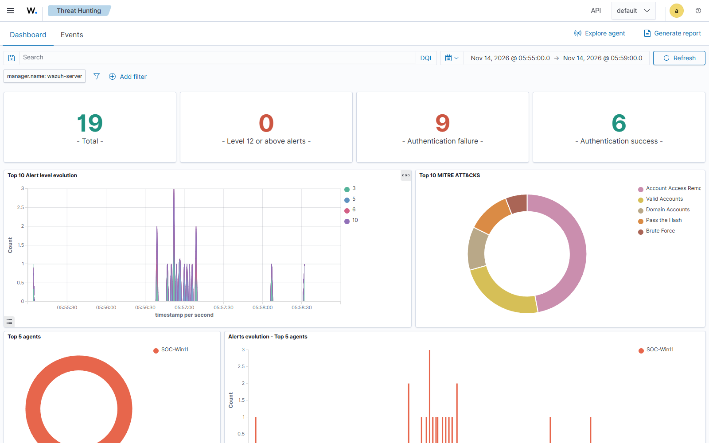
</details>

<details>
<summary><b>2. Filtro pelo IP de origem (Events)</b></summary>

Consulta `agent.name:SOC-Win11 and data.win.eventdata.ipAddress:10.0.10.30`, período 05:56:30 → 05:57:15: **11 hits**. Lendo de baixo para cima:

- 05:56:39, **92652**: login anônimo (NTLM V1), a sondagem do SMB.
- 05:56:50 → 05:57:06, **60122** (nível 5): uma falha a cada ~2 s.
- 05:57:04, **60204** (nível 10): é a **8ª falha**, transformada em alerta pela correlação.
- 05:57:09, **92652**: login com sucesso como `joao.teste`.


</details>

<details>
<summary><b>3. Detalhe do alerta 60204 (Document Details → Table)</b></summary>

| Campo | Valor | Significado |
|---|---|---|
| `ipAddress` / `ipPort` | 10.0.10.30 / 39612 | Origem: o Kali (porta aleatória do cliente). |
| `targetUserName` | joao.teste | Conta atacada. |
| `logonType` | 3 | Login pela rede (SMB). Teclado seria 2; RDP, 10. |
| `status` / `subStatus` | 0xC000006D / 0xC000006A | Usuário **existe**, senha errada (usuário inexistente seria 0xC0000064). |
| `failureReason` | %%2313 | "Nome de usuário desconhecido ou senha incorreta". |
| `channel` / `eventID` | Security / 4625 | "Uma conta falhou ao fazer logon". |


</details>

<details>
<summary><b>4. A regra por trás do alerta: correlação e MITRE</b></summary>

- `rule.level` **10**: uma falha sozinha é nível 5; a repetição sobe para 10.
- `rule.frequency` **8**: só dispara depois de 8 eventos parecidos na janela de tempo (**correlação**). `previous_output` guarda os eventos que somaram.
- `rule.mitre`: **T1110**, Credential Access → Brute Force.
- `rule.pci_dss` / `gdpr` / `hipaa` / `nist_800_53` / `tsc`: requisitos de conformidade ligados ao monitoramento de acessos inválidos.


</details>

<details>
<summary><b>5. O login com sucesso: a prova do comprometimento</b></summary>

Consulta `rule.id:92652 and data.win.eventdata.targetUserName:joao.teste`:

- **Mesmo IP** (10.0.10.30) e **mesma conta** das 9 falhas, `logonType 3`.
- `lmPackageName` NTLM V2 / `keyLength` 128: autenticação completa (a sondagem anônima era NTLM V1, chave 0).
- `elevatedToken` %%1843 ("Não"): sem privilégio de administrador.
- `targetLogonId` 0x1bf006: o ID da sessão, para rastrear o que ela fez depois.
- A regra chama de *"possible pass-the-hash"*, mas o contexto (9 erros e depois 1 acerto) mostra **senha descoberta**.


</details>

---

## Cenário 2 — PowerShell codificado (`-EncodedCommand`)

📄 **Relatório de incidente (1 página):** [relatorios/relatorio-cenario2-powershell-codificado.pdf](relatorios/relatorio-cenario2-powershell-codificado.pdf)

| | |
|---|---|
| **Data** | 15/11/2026 (execuções às 19:21 e 21:07 **UTC**) e 16/11/2026 (tuning, 04:26 UTC) |
| **Onde** | SOC-WIN11, usuário comum `cannibalsec` (integridade **Medium**, sem admin) |
| **Simulação** | Um comando PowerShell **benigno** (só escreve uma frase verde na tela) codificado em Base64 e executado com `powershell.exe -EncodedCommand` |
| **MITRE ATT&CK** | [T1059.001 – PowerShell](https://attack.mitre.org/techniques/T1059/001/) · [T1027 – Obfuscated Files or Information](https://attack.mitre.org/techniques/T1027/) |
| **Resultado** | ✅ Detectado (regra 92057, nível 12) · visibilidade melhorada (evento 4104 + regra **100210**) · ruído ajustado (regra **100211**) |

> Por que isso importa: atacantes usam `-EncodedCommand` para esconder o comando de quem lê a linha de comando (e de filtros simples por palavra-chave). O Base64 aqui **não é criptografia**, só um disfarce: é texto UTF-16LE convertido para Base64.

Scripts e regras usados (escritos **com apoio de IA**, executados e validados por mim no lab): [`configuracoes/`](configuracoes/)

### O que eu fiz, em ordem

1. **Ataque simulado** ([`cenario2-simulacao-encodedcommand.ps1`](configuracoes/cenario2-simulacao-encodedcommand.ps1)): montei o comando, converti para Base64 e executei com `-EncodedCommand`.
2. **Detecção**: no Wazuh, filtrei `rule.level >= 12` e encontrei o alerta **92057** (*Powershell.exe spawned a powershell process which executed a base64 encoded command*), nível 12, T1059.001.
3. **Investigação do alerta**: no campo `data.win.eventdata.commandLine` estava só o Base64 (`-EncodedCommand VwByAGkAdABlAC0ASABv…`). O `parentImage` era `powershell.exe` (um PowerShell abrindo outro) e a integridade era **Medium** (usuário comum).
4. **Decodificação manual**: copiei o Base64 do alerta e decodifiquei no PowerShell com `[Text.Encoding]::Unicode.GetString([Convert]::FromBase64String(...))`, revelando o `Write-Host "LAB-SOC Cenario 2..."`.
5. **Melhoria de visibilidade** ([`cenario2-ativar-scriptblock.ps1`](configuracoes/cenario2-ativar-scriptblock.ps1)): ativei o **Script Block Logging** (evento **4104**) e fiz o agente Wazuh ler o canal `Microsoft-Windows-PowerShell/Operational`.
6. **Regra personalizada 100210** ([`cenario2-local_rules.xml`](configuracoes/cenario2-local_rules.xml)): a regra oficial 91802 recebe os eventos 4104 com nível 0 (sem alerta). A 100210 é "filha" dela e transforma cada Script Block em alerta de nível 4.
7. **Segunda execução** do mesmo ataque, agora com o 4104 ativo, e correlação dos eventos pelo PID.
8. **Tuning (regra 100211)**: silenciei o ruído exato do console (`prompt`, `$global:?`, `$Host`) e validei com comandos de teste (`whoami`, `Get-Date`).

### Linha do tempo da segunda execução (UTC, horário do evento no Windows)

| Horário | Fonte | PID | O que foi registrado |
|---|---|---|---|
| 21:07:12.135 | 4104 → **100210** | 5572 | `powershell.exe -EncodedCommand $enc`, digitado na janela do usuário |
| 21:07:12.336 | Sysmon 1 → **92057** (nível 12) | **1048** (pai: **5572**) | Novo `powershell.exe` com o Base64 na linha de comando |
| 21:07:14.299 | 4104 → **100210** | 1048 | `Write-Host "LAB-SOC Cenario 2 - ..."`, **o código já decodificado** |

Os alertas chegaram ao índice cerca de 3 minutos depois (`@timestamp` ≈ 21:10). Por isso o relatório usa o horário do evento (`data.win.system.systemTime`), não o de ingestão.

### Análise

1. **O que o alerta 92057 mostra?** O **comportamento**: um PowerShell criou outro PowerShell com um comando em Base64. Ele dispara o alarme, mas o conteúdo continua escondido.
2. **O que o 4104 (regra 100210) acrescenta?** O **conteúdo**. Para executar, o PowerShell precisa decodificar o Base64 na memória, e o Windows registra o código decodificado no evento 4104 antes de executar. O analista lê o código sem decodificar nada à mão.
3. **Como ligar os dois?** Pelo PID. O 92057 traz `parentProcessId = 5572`, que é o PowerShell onde os comandos foram colados (o mesmo PID do 4104 com `-EncodedCommand $enc`). O filho (1048) é quem registra o código decodificado. Isso monta a árvore de processos: se o pai fosse `WINWORD.EXE`, por exemplo, seria indício de documento com macro maliciosa.
4. **Foi malicioso?** Não. O código decodificado só escreve uma frase na tela, sem download, conexão ou alteração no sistema. Num ambiente real, este mesmo raciocínio decide se o caso escala ou fecha.

> Em uma frase: **o Sysmon me diz que um PowerShell executou código escondido; o Script Block Logging me diz qual foi o código.**

### Triagem dos outros alertas de nível alto da janela

| Regra | Nível | O que era | Veredito |
|---|---|---|---|
| 92057 | 12 | O PowerShell codificado simulado | **Atividade simulada** (o próprio teste) |
| 92213 | 15 | Arquivo `__PSScriptPolicyTest_*.ps1` criado pelo PowerShell (teste de política de execução que o próprio PowerShell faz ao iniciar), em processos do usuário | **Falso positivo** |
| 92058 | 12 | `sdbinst.exe` como SYSTEM, iniciado pelo serviço de Compatibilidade de Programas (`PcaSvc`, via `rundll32 PcaSvc.dll,PcaPatchSdbTask` ou `svchost -s PcaSvc`), repetindo ao longo do dia | **Falso positivo** |
| 92055 | 12 | `FodHelper.exe -Embedding`, com pai `svchost.exe -k DcomLaunch` e **sem** nenhuma alteração de registro em `ms-settings` / `DelegateExecute` (que é o que o bypass de UAC usa) | **Provável falso positivo**: o padrão bate com o Windows abrindo o FodHelper via COM. Não consegui confirmar se as Configurações do Windows foram abertas nesse horário |

### Tuning: separar ruído de sinal

Com a regra 100210 ativa, **todo** script block vira alerta, inclusive o que o próprio console do PowerShell executa a cada comando (`prompt`, `$global:?`, `$Host`). No boot também apareceram PowerShells do SYSTEM criando `__PSScriptPolicyTest_*.ps1` (regra 92205) e executando trechos inofensivos.

- **Conclusão pelas evidências, não por suposição:** o fato de rodar "sozinho, no boot, como SYSTEM" **não** prova que é benigno, porque é exatamente assim que a persistência de um atacante se parece. O que fecha o caso é o **conteúdo** inofensivo e o padrão conhecido do próprio PowerShell. O processo pai desses PowerShells de boot não foi registrado, então o serviço que os iniciou ficou como *causa provável*, não confirmada.
- **Regra 100211 (nível 0):** filha da 100210 e **ancorada** com `^...$`: só some o texto que for **exatamente** `prompt`, `$global:?` ou `$Host`. Um código malicioso que apenas *contenha* essas palavras continua gerando alerta. Uma exceção larga (ex.: "ignorar tudo do SYSTEM") abriria um ponto cego.
- **Validação:** depois do reload, `whoami` e `Get-Date` continuaram gerando o 100210, e os `prompt` / `$global:?` que antes acompanhavam cada comando pararam de aparecer.
- **Ruído ainda conhecido e não filtrado (de propósito):** `{ Set-StrictMode -Version 1; $this.DisplayHint }` (formatação de saída) e `Set-Alias ... Cim...` (carga de módulo). Tuning é contínuo: observar primeiro, filtrar só o que for comprovadamente benigno.

### O que aprendi

- **Base64 não é proteção**, é disfarce. Qualquer analista decodifica em uma linha.
- **Detecção e visibilidade são coisas diferentes.** Sem o 4104, eu sabia *que* algo escondido rodou; com ele, eu sei *o quê*.
- **O PID liga fontes diferentes** (Sysmon e PowerShell) numa mesma história.
- **Atraso de ingestão existe** (~3 min aqui): o horário do evento e o horário do alerta não são o mesmo campo.
- **Toda exceção de tuning precisa ser estreita e testada**: confirmar que o ruído sumiu *e* que a detecção continua funcionando.

### Como reproduzir a consulta

No Wazuh → **Threat Hunting → Events**, adicionando as colunas `data.win.eventdata.scriptBlockText`, `data.win.eventdata.commandLine` e `data.win.eventdata.parentProcessId`:

```
rule.id:100210 or rule.id:92057
```

Evidência bruta (69 alertas das regras 92057, 92058, 92213, 92055, 92205 e 100210, documentos completos exportados do indexador): [`evidencias/cenario2-alertas-wazuh.json`](evidencias/cenario2-alertas-wazuh.json)

### Prints do passo a passo

<details open>
<summary><b>1. Execução</b>: o comando benigno codificado em Base64 e executado com <code>-EncodedCommand</code></summary>

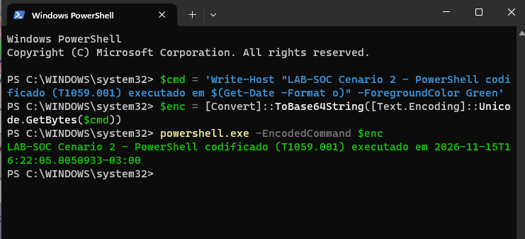
</details>

<details>
<summary><b>2. O primeiro olhar</b>: 214 eventos na janela, a maioria ruído normal do Windows (atualização do Defender, serviços)</summary>

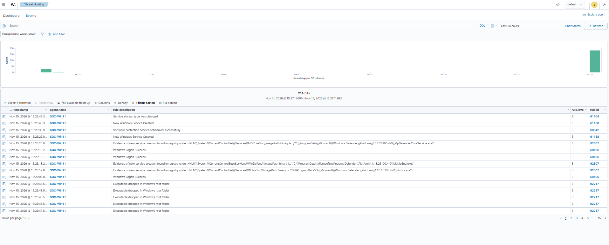
</details>

<details>
<summary><b>3. Triagem por severidade</b>: <code>rule.level >= 12</code> reduz para 5 alertas</summary>

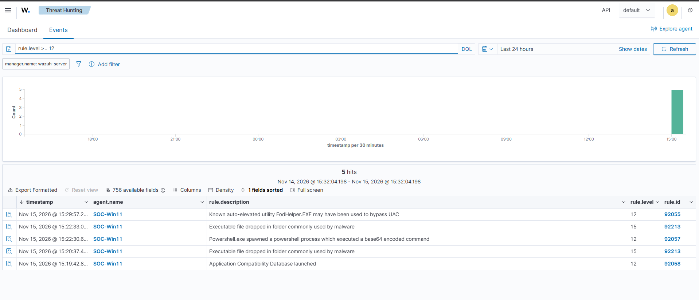
</details>

<details>
<summary><b>4. Alerta 92057</b>: o Base64 na linha de comando, o pai <code>powershell.exe</code> e a integridade Medium</summary>

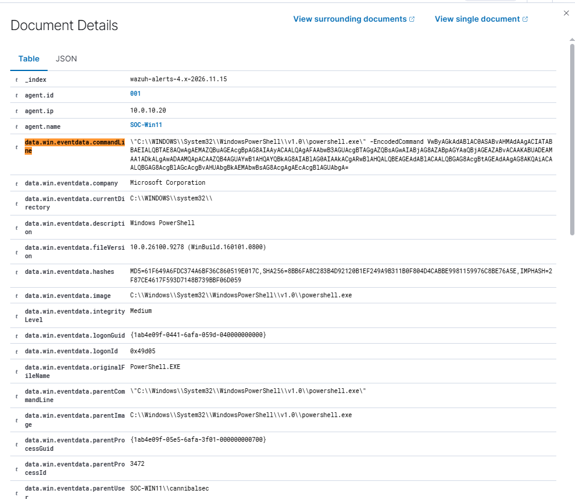
</details>

<details>
<summary><b>5. Decodificação manual</b>: o Base64 vira o <code>Write-Host</code> original</summary>

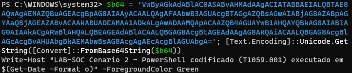
</details>

<details>
<summary><b>6. Melhoria</b>: ativando o Script Block Logging (4104) e o canal no agente Wazuh</summary>

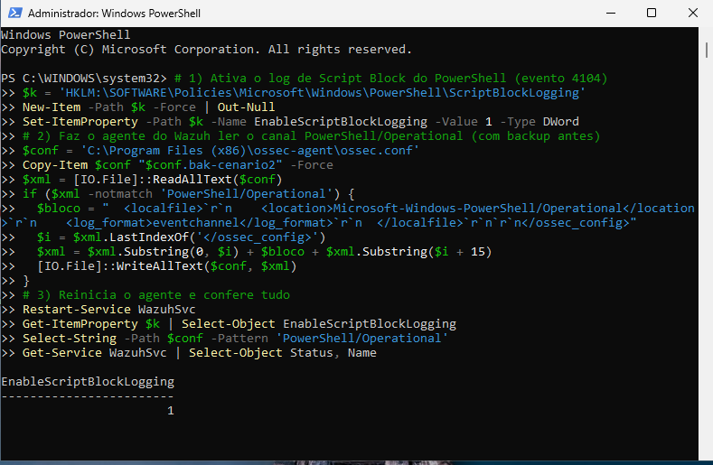
</details>

<details>
<summary><b>7. Regra personalizada 100210</b> no <code>local_rules.xml</code></summary>

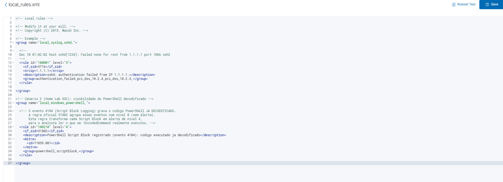
</details>

<details>
<summary><b>8. Segunda execução</b> do mesmo ataque, agora com o 4104 ativo</summary>

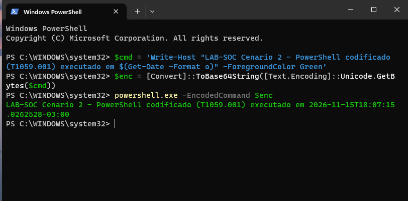
</details>

<details>
<summary><b>9. Painel</b>: os alertas 100210 (nível 4) e 92057 (nível 12) juntos, MITRE PowerShell</summary>

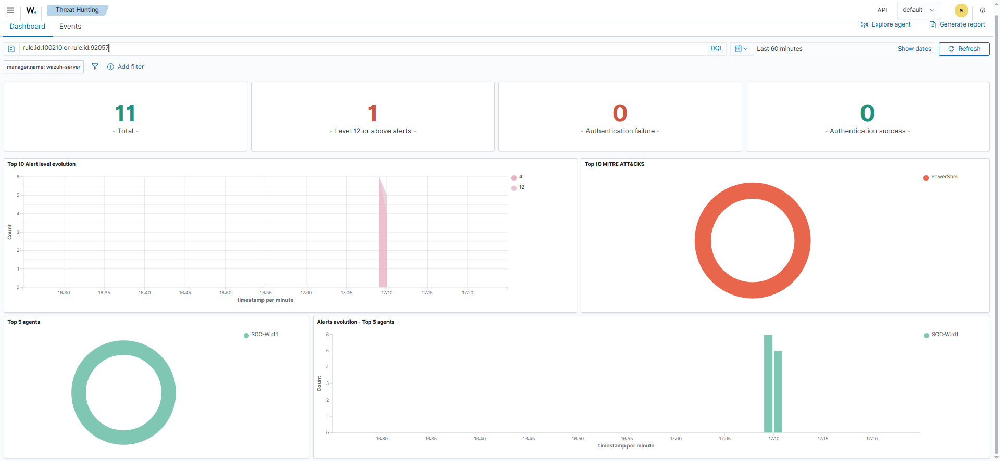
</details>

<details>
<summary><b>10. Correlação</b>: <code>scriptBlockText</code> decodificado, <code>commandLine</code> em Base64 e <code>parentProcessId</code> 5572</summary>

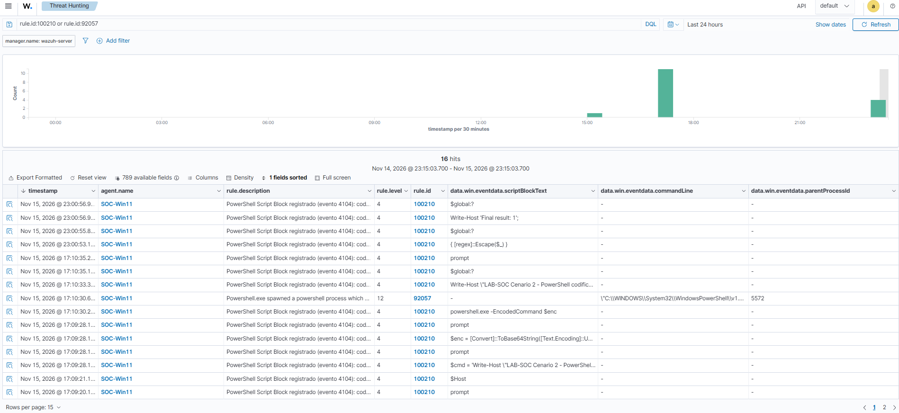
</details>

<details>
<summary><b>11. Tuning</b>: a regra 100211 (nível 0) logo abaixo da 100210</summary>

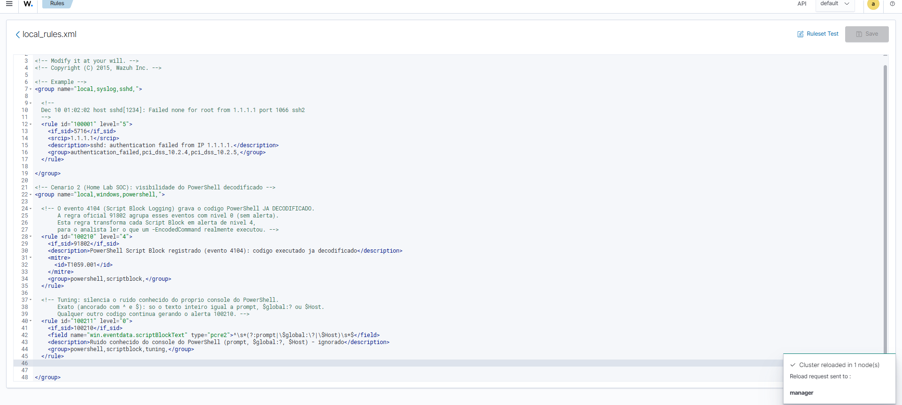
</details>

<details>
<summary><b>12. Teste do tuning</b>: <code>whoami</code> e <code>Get-Date</code> numa janela nova</summary>

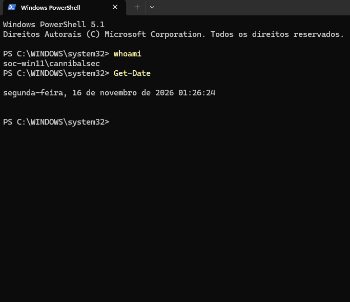
</details>

<details>
<summary><b>13. Tuning validado</b>: os comandos aparecem, o <code>prompt</code> / <code>$global:?</code> não</summary>

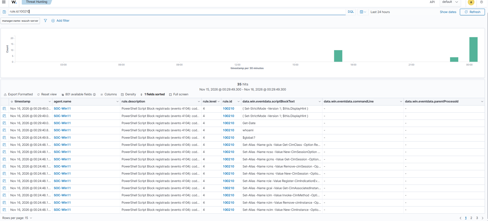
</details>

---

## Próximos cenários

- [x] **Cenário 2:** PowerShell ofuscado (`-EncodedCommand`), T1059.001
- [ ] **Cenário 3:** persistência (Run key / tarefa agendada), T1547 / T1053
