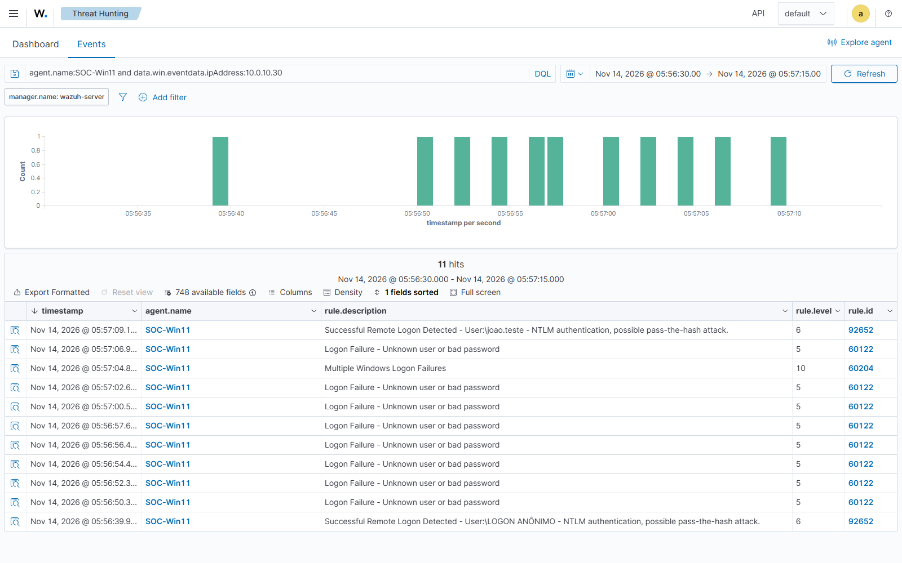
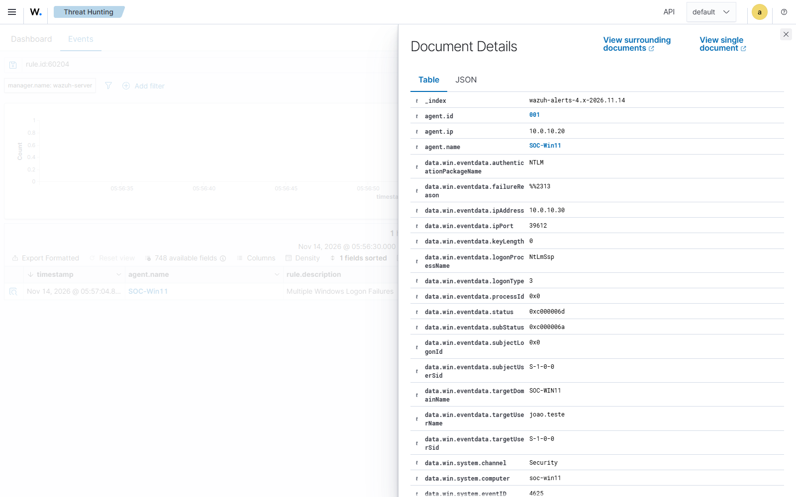
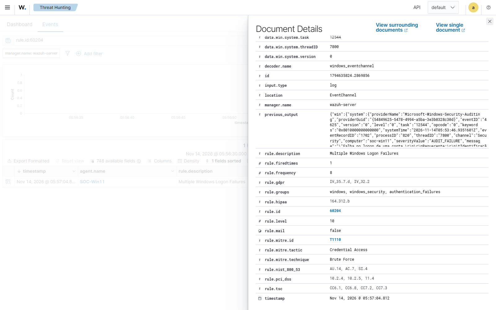
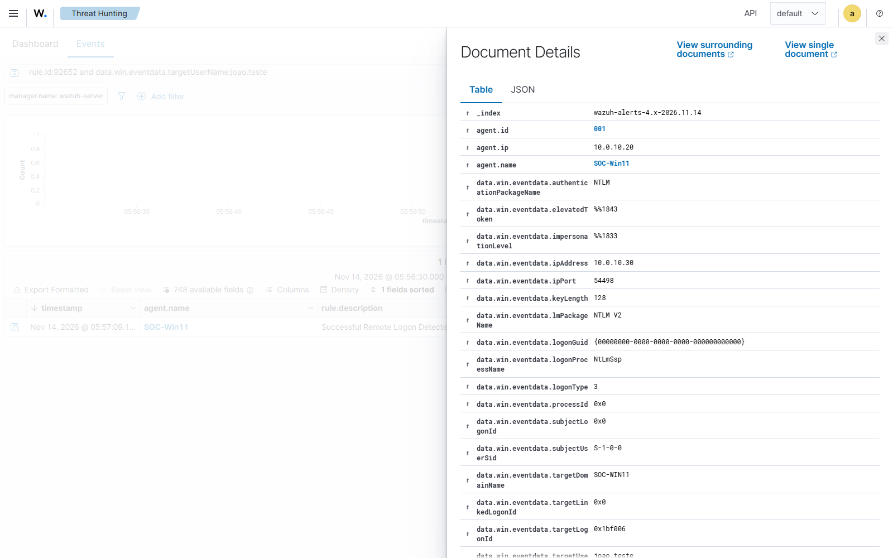

# 02 — Home Lab de SOC

Laboratório de detecção montado em VirtualBox para simular ataques reais e investigá-los como um analista de SOC N1: **Wazuh (SIEM) + Windows 11 com Sysmon + Kali Linux (atacante)**.

## Arquitetura

| VM | Função | IP |
|---|---|---|
| SOC-Wazuh | Wazuh 4.14 (manager + indexer + dashboard), OVA oficial | 10.0.10.10 |
| SOC-Win11 | Vítima: Windows 11 Enterprise + Sysmon + agente Wazuh | 10.0.10.20 |
| SOC-Kali | Atacante: Kali Linux 2026.3 | 10.0.10.30 |

- Rede **NAT Network isolada** (`10.0.10.0/24`): as VMs se enxergam, mas não enxergam a rede doméstica.
- O painel do Wazuh é acessado pelo host via **port forwarding** (`127.0.0.1:8443 → 10.0.10.10:443`), sem expor a rede do lab.
- O agente Wazuh no Windows lê os canais `Security` e `Microsoft-Windows-Sysmon/Operational`.
- Snapshots em cada etapa (`00-base-limpa`, `01-sysmon-agente`) permitem voltar a um estado limpo depois de cada ataque.

---

## Cenário 1 — Brute force de senha via SMB

| | |
|---|---|
| **Data** | 14/11/2026, 05:56–05:57 **UTC** |
| **Atacante** | 10.0.10.30 (Kali) |
| **Alvo** | SOC-WIN11, conta local `joao.teste` |
| **Ferramenta** | NetExec (`nxc smb`) com uma pequena lista de senhas |
| **MITRE ATT&CK** | [T1110 – Brute Force](https://attack.mitre.org/techniques/T1110/) → [T1078 – Valid Accounts](https://attack.mitre.org/techniques/T1078/) |
| **Resultado** | ⚠️ **Conta comprometida**: a senha foi descoberta |

### Linha do tempo (UTC)

| Horário | Evento Windows | Regra Wazuh | Nível | O que aconteceu |
|---|---|---|---|---|
| 05:56:39 | 4624 / 4634 | 92652 / 60137 | 6 / 3 | **Reconhecimento**: login **anônimo** (null session, NTLM V1) vindo de 10.0.10.30, seguido de logoff. |
| 05:56:50 → 05:57:06 | 4625 ×9 | 60122 | 5 | **9 falhas de login** em `joao.teste`, uma a cada ~2 s, todas de 10.0.10.30. |
| **05:57:04** | 4625 | **60204** | **10** | 🚨 **Correlação**: o Wazuh agrupa as falhas repetidas e gera o alerta *Multiple Windows Logon Failures* (T1110). |
| **05:57:09** | 4624 | **92652** | 6 | ✅ **Login remoto com sucesso** como `joao.teste`, de 10.0.10.30, logonType 3 (rede), NTLM V2. |
| 05:57:09 | 4634 | 60137 | 3 | Logoff imediato: o atacante só validou a credencial. |

### Campos-chave dos eventos

| Campo | Valor | Interpretação |
|---|---|---|
| `ipAddress` | `10.0.10.30` | Mesma origem nas falhas e no sucesso → mesmo ator. |
| `targetUserName` | `joao.teste` | Conta-alvo. |
| `logonType` | `3` | Logon **pela rede** (SMB), não no teclado da máquina. |
| `authenticationPackageName` | `NTLM` | Autenticação NTLM, típica de ferramentas de ataque contra SMB. |
| `status` / `subStatus` | `0xC000006D` / `0xC000006A` | **Senha errada para um usuário que existe.** O atacante já sabia um nome de conta válido. |

### Análise

1. **Foi brute force?** Sim. São 9 falhas em ~16 s, todas da mesma origem e contra a mesma conta, um padrão automatizado que nenhum humano digitando produz.
2. **O ataque teve sucesso?** **Sim.** Dois segundos depois da última falha, a mesma origem faz login com sucesso na mesma conta. A sequência *várias falhas → um sucesso* é o indicador clássico de credencial descoberta. Isso deixa de ser "tentativa" e passa a ser **incidente**.
3. **Houve preparação?** Sim. O login anônimo às 05:56:39 é a enumeração inicial que o NetExec faz no SMB antes de testar senhas.
4. **Os outros "Windows Logon Success" (60106) da janela são do atacante?** **Não.** São logons da conta `SISTEMA` com `logonType 5` (serviço), iniciados pelo `services.exe`. É atividade normal do Windows: **falso positivo descartado**.

### Pontos de atenção encontrados na investigação

- **Mapeamento MITRE das regras nem sempre é exato.** A regra 92652 rotula o sucesso como *possible pass-the-hash* (T1550.002), mas aqui o atacante usou a **senha** descoberta, não um hash. A 60122 marca cada falha como T1531 (*Account Access Removal*), o que não se aplica. O analista deve validar o contexto, não copiar a etiqueta da regra.
- **Nenhum bloqueio de conta ocorreu.** A política de *account lockout* não interrompeu o ataque. O que desacelerou as tentativas foi o limitador de autenticação SMB do Windows 11 24H2 (por isso o intervalo de ~2 s entre falhas).
- **O alerta crítico (60204) disparou, mas não impediu nada.** Sem resposta ativa configurada, o SIEM detectou e o atacante entrou 5 s depois. Detecção sem resposta não basta.

### Recomendações (resposta ao incidente)

1. **Conter:** desabilitar/resetar a senha de `joao.teste` e encerrar sessões abertas.
2. **Bloquear** 10.0.10.30 no firewall (ou via *Active Response* do Wazuh, automaticamente ao disparar a regra 60204).
3. **Investigar o pós-login:** o que a conta acessou depois das 05:57:09 (compartilhamentos, processos no Sysmon, novos serviços).
4. **Prevenir:** política de bloqueio de conta (ex.: 5 tentativas / 15 min), senhas fortes e restrição de SMB a quem realmente precisa.

### Como reproduzir a consulta

No Wazuh → **Threat Hunting → Events**, com o período cobrindo o ataque:

```
agent.name:SOC-Win11 and data.win.eventdata.ipAddress:10.0.10.30
```

Evidência bruta (19 alertas da janela do ataque, documentos completos exportados do indexador): [`evidencias/cenario1-alertas-wazuh.json`](evidencias/cenario1-alertas-wazuh.json)

🎬 **Replay 3D interativo deste ataque:** [cannibaligor.github.io/infosec-portfolio](https://cannibaligor.github.io/infosec-portfolio/#replay)

### Prints do Wazuh

<details open>
<summary><b>Threat Hunting</b>: 19 alertas, 9 falhas de autenticação e as técnicas MITRE da janela do ataque</summary>


</details>

<details>
<summary><b>Eventos filtrados pelo IP do atacante</b>: falhas a cada ~2 s, alerta 60204 e o sucesso no fim</summary>


</details>

<details>
<summary><b>Alerta 60204</b>: origem, conta, logonType 3 e códigos de erro</summary>


</details>

<details>
<summary><b>Alerta 60204, regra</b>: nível 10, frequência 8, MITRE T1110</summary>


</details>

<details>
<summary><b>Alerta 92652</b>: login bem-sucedido de 10.0.10.30 como joao.teste</summary>


</details>

---

## Próximos cenários

- [ ] **Cenário 2:** PowerShell ofuscado (`-EncodedCommand`), T1059.001
- [ ] **Cenário 3:** persistência (Run key / tarefa agendada), T1547 / T1053
